# UPI Spend Analyzer

[](https://github.com/Omkar210404/upi-spend-analyzer/actions/workflows/ci.yml)

Analyse a bank or UPI statement export **entirely inside your browser**. No server, no upload,
no account, no analytics.

**Live demo:** https://omkar210404.github.io/upi-spend-analyzer/ (press "Try with sample data")

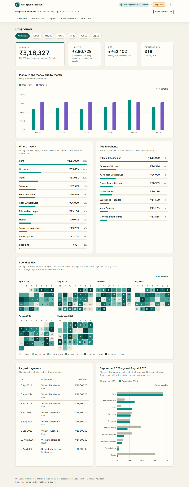

## The problem

A bank statement is a few hundred lines like
`UPI/DR/423456789012/CHAI CORNER CAFE/DEMO/chaicorner@okdemo/Tea`. To find out where the money
went you either read it line by line, or hand the file to an app that uploads it to someone's
server. A statement is about the most personal file most people have.

This app reads the file on your own device and gives you:

- money in and money out by month, spend by category, top merchants, a calendar of daily spend,
  the largest payments, and one month against the month before;
- the payee, UPI handle and reference number pulled out of each narration;
- categories from keyword rules you can edit, with one-click correction per transaction or per
  merchant;
- four kinds of "signals", each shown with the rule and the numbers behind it: recurring
  payments, possible duplicate charges, unusually large payments, unusually heavy months;
- a CSV export of the categorised transactions.

**It is not financial advice.** It adds up what is in a file and points at patterns. What to do
about them, if anything, is yours to decide.

## Privacy

### What "nothing leaves your browser" means

The app is a set of static files: HTML, CSS, JavaScript and two font files. Your browser
downloads them when you open the page. After that:

- **Your statement is read from your disk into the tab's memory.** There is no server for it to
  go to. This project has no backend at all.
- **Transactions are never stored.** Not in localStorage, not in IndexedDB, not in a cookie.
  Reload the tab and they are gone.
- **Only the columns you map are read.** Everything else in the file (an account-number column,
  for instance) is discarded at import. Card and account fragments inside narrations
  (`XXXXXXXXXXXX1234`) are cut out at the same moment.
- **The page is not allowed to contact a server.** It ships with this Content-Security-Policy:

  ```
  default-src 'none'; script-src 'self'; style-src 'self'; img-src 'self'; font-src 'self';
  connect-src 'none'; worker-src 'none'; object-src 'none'; base-uri 'none'; form-action 'none'
  ```

  `connect-src 'none'` makes the browser refuse every `fetch`, XHR, WebSocket, EventSource and
  beacon the page attempts, including to its own site. Scripts, styles, images and fonts can
  only come from the same site. There are no third-party scripts, no CDN, no web workers.

- **What is stored:** your category rules, your category choices, saved column mappings and the
  theme, in this browser's localStorage under four keys starting `upi-spend-analyzer:v1:`. You
  can export them as JSON or delete them from the "Rules and data" tab.
- **It never asks for** an account number, card number, PIN, Aadhaar or PAN. Password-protected
  PDFs are refused rather than prompting for a password, because statement passwords are often
  built from those details.

### One exception, stated plainly

The PDF reader (pdf.js) is large, so its code is downloaded only when you choose a PDF. That is
a request **after** the page has loaded: a plain `GET` for JavaScript files from the same site,
with nothing about your file in it. Opening CSV files, or using the sample, makes no request at
all.

### Check it yourself

1. Open the page, then open developer tools (F12) and the **Network** tab.
2. Tick **Preserve log**, reload, and wait for the page to finish loading.
3. Clear the list. Open a CSV statement (or the sample) and click through every tab, change a
   category, export a CSV.
4. The list stays empty.
5. For a blunter test: after the page has loaded, set the Network tab to **Offline** or turn off
   Wi-Fi. Everything still works, except opening a PDF for the first time.

### The automated proof

`npm run test:e2e` drives a real browser against the production build and checks seven things.
The last run on this machine: **7 of 7 passed**.

| Check                                                                                                | What it shows                                                                                                          |
| ---------------------------------------------------------------------------------------------------- | ---------------------------------------------------------------------------------------------------------------------- |
| The shipped policy equals `csp.ts`                                                                   | The tested policy is the deployed policy                                                                               |
| The page loads only from its own origin                                                              | No CDN, no third party                                                                                                 |
| Full flow after load: sample, every tab, override, rule edit, CSV and JSON export, theme, CSV import | **Zero** requests sent, zero attempted, zero policy violations                                                         |
| Storage after use                                                                                    | Only the four allowed keys; no narration, reference, handle or amount in them; no cookies, sessionStorage or IndexedDB |
| The page tries `fetch`, XHR, WebSocket, an image, a script and a worker                              | All blocked by the policy; none reaches the network                                                                    |
| A PDF is opened                                                                                      | Only same-site `GET`s for `.js` files under `assets/`, no request body                                                 |
| A PDF with no text                                                                                   | Refused with a clear message                                                                                           |

The test cannot reach the internet itself: every request not addressed to the local preview
server is aborted. It also caught a real leak during development: keeping the open tab in the
URL made the browser fetch the page icon again on every tab change, so that was removed.

### What the policy cannot do

A policy written in a `<meta>` tag (GitHub Pages cannot send response headers) cannot forbid
another site from framing this page, and no policy can stop a page from navigating the browser
to another address. The app has no code that does either, and the source is here to check.

## Screenshots

All taken by `npm run screenshots` from the production build running on the synthetic sample.

|                                                             |                                                           |
| ----------------------------------------------------------- | --------------------------------------------------------- |
| 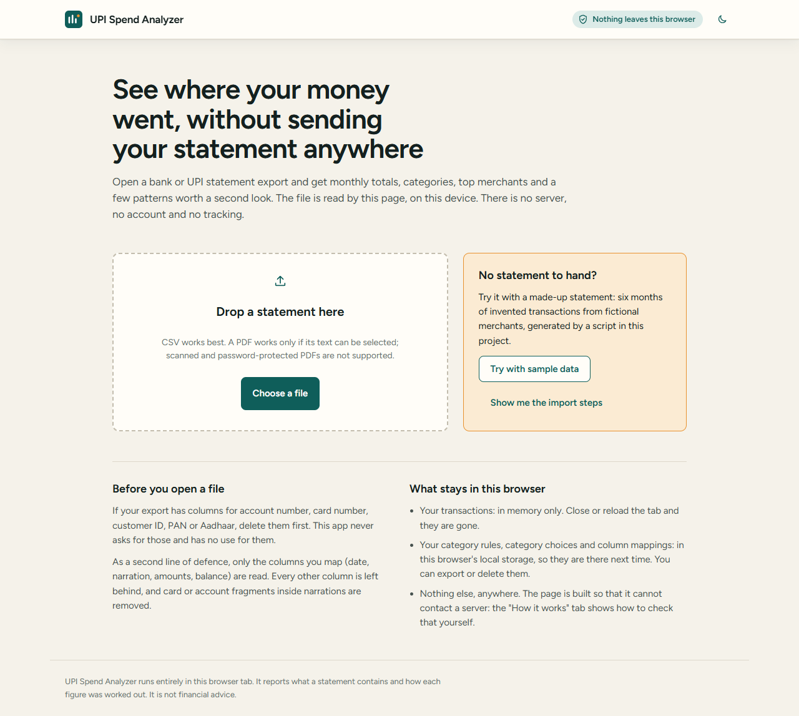           | 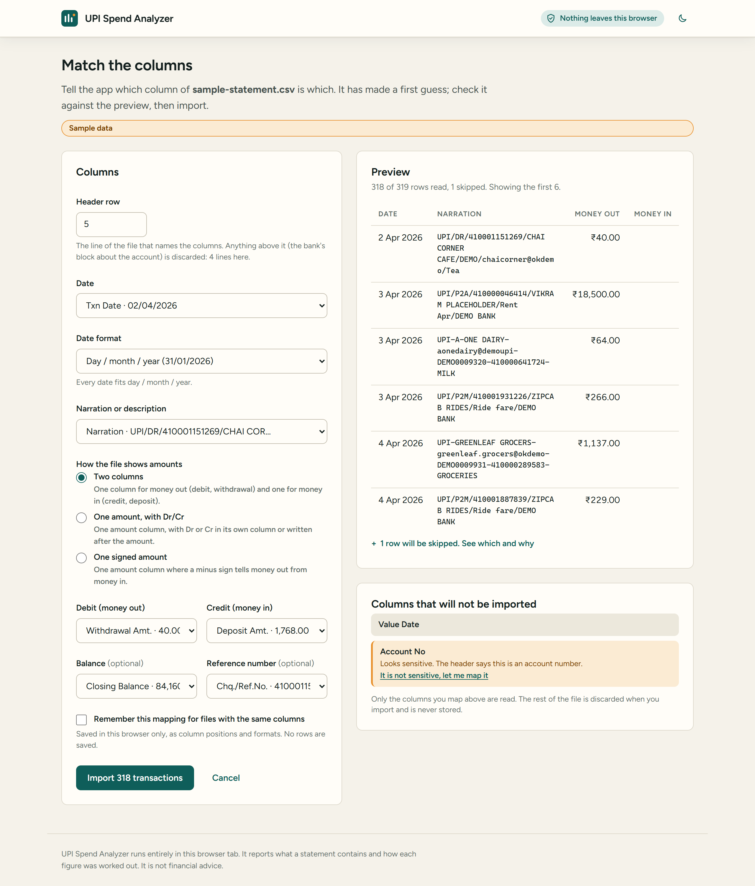     |
| Start                                                       | Column mapping, with the account-number column flagged    |
| 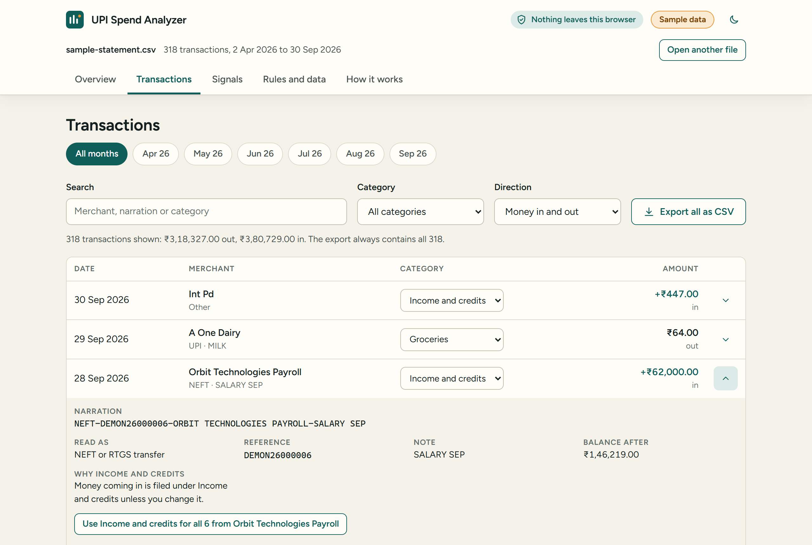    | 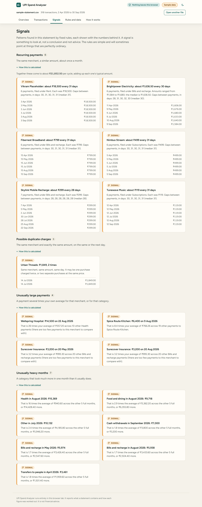            |
| Transactions, one row opened                                | Signals                                                   |
| 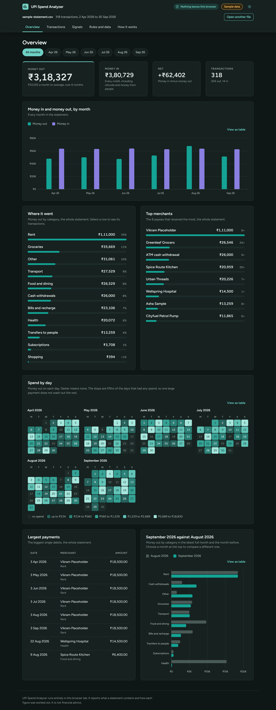 | 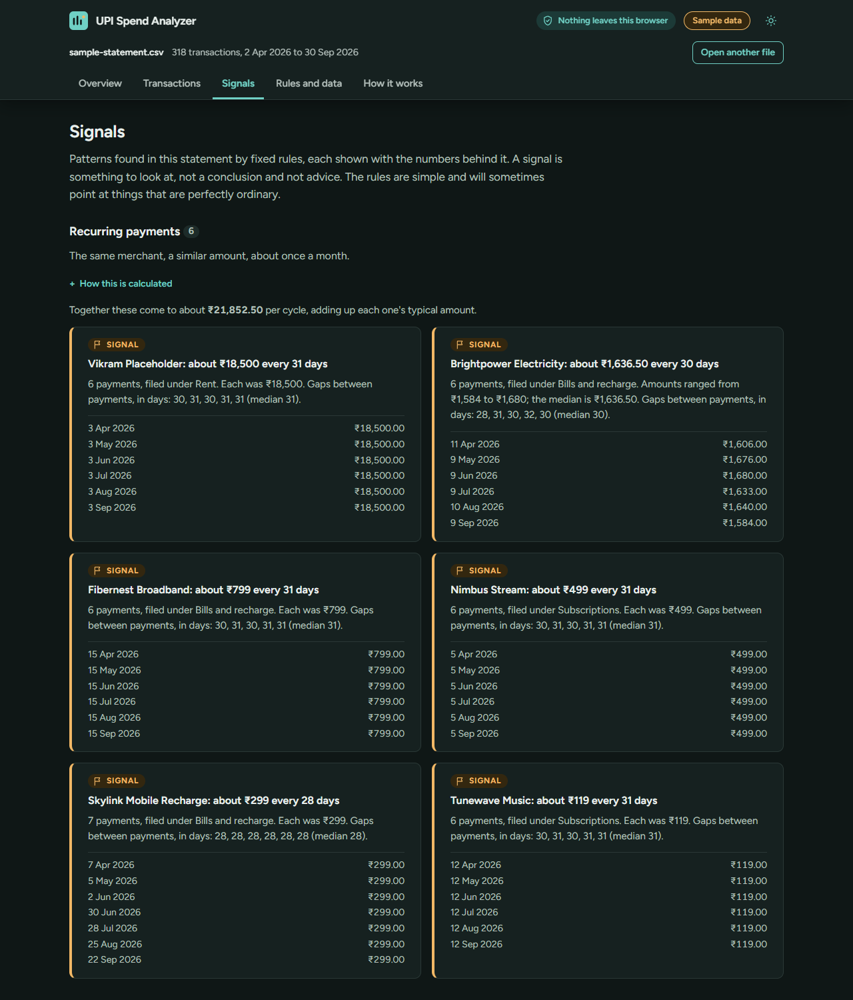 |
| Overview, dark                                              | Signals, dark                                             |
| 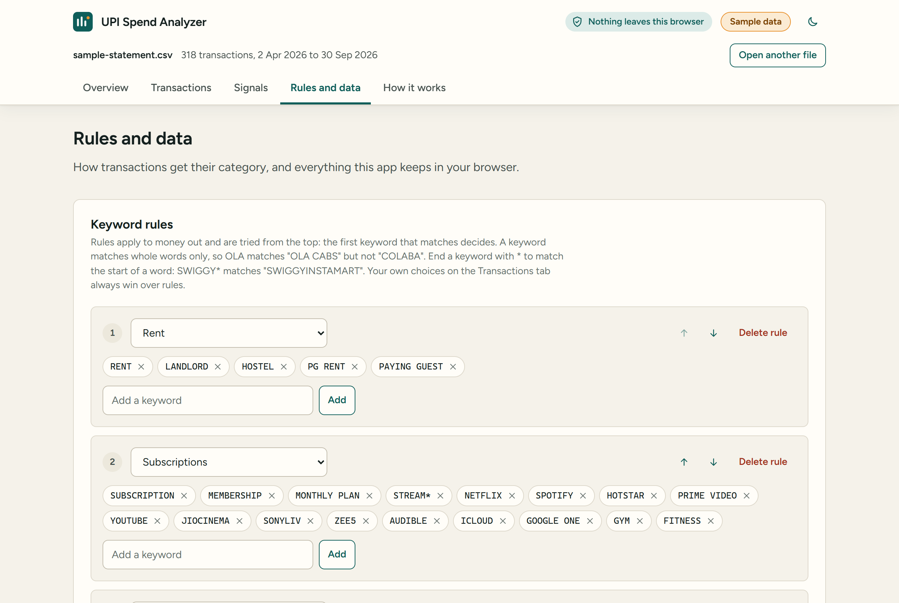                  | 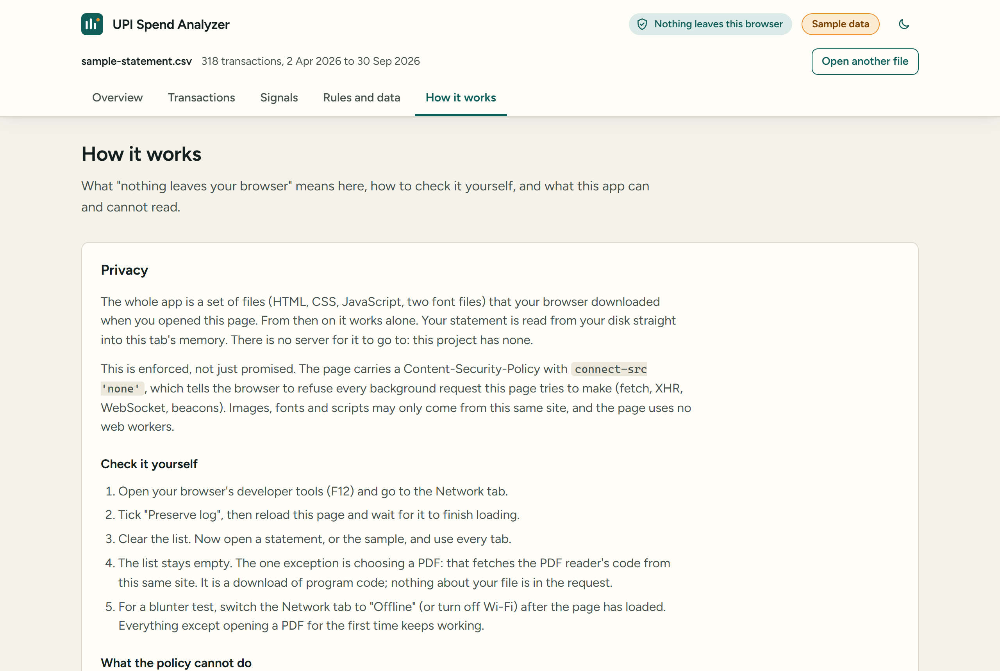  |
| Rules and data                                              | How it works                                              |

Phone width (390px):

| 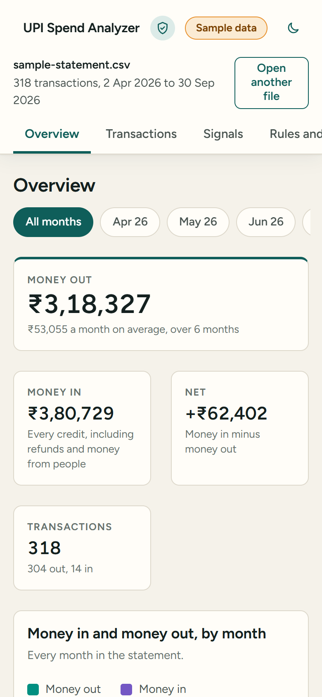 | 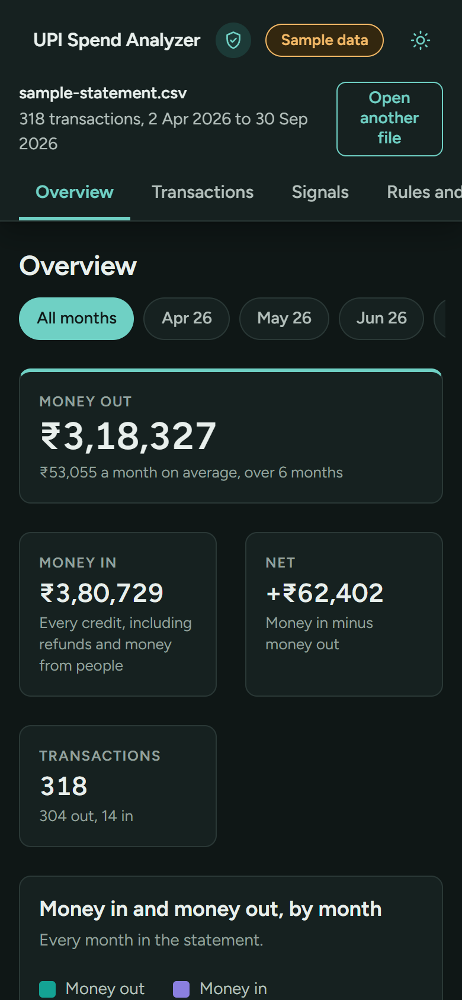 | 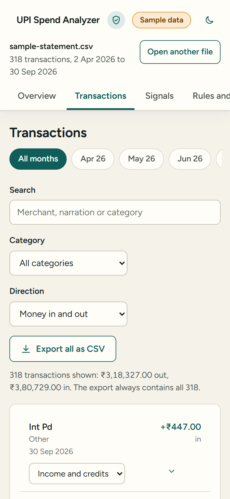 |
| ------------------------------------------------------------------- | ----------------------------------------------------------------- | -------------------------------------------------------------------- |

## Run it

Needs Node 22.13 or newer.

```bash
npm install
npm run dev          # development server (no CSP here: hot reload needs a WebSocket)
npm run build        # production build in dist/, with the CSP
npm run preview      # serve the production build at http://localhost:4173
```

Checks:

```bash
npm run lint
npm run format:check
npm run typecheck
npm test             # unit tests (Vitest, no browser, no internet)
npm run build && npm run check:dist && npm run test:e2e
npm run check:repo   # no statement files or identifier-shaped values in the repo
```

`npm run test:e2e` needs a Chromium-based browser. It uses Playwright's Chromium if installed
(`npx playwright-core install chromium`), otherwise Edge or Chrome.

Other scripts: `npm run sample` regenerates the synthetic statement; `npm run screenshots`
retakes the pictures above.

## How it is built

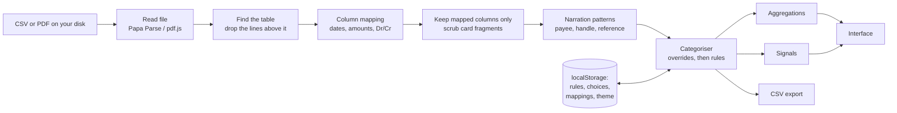

| Folder                                             | What is in it                                                                                                                                   |
| -------------------------------------------------- | ----------------------------------------------------------------------------------------------------------------------------------------------- |
| `src/core/import`                                  | CSV reading, header detection, date and amount parsing, column mapping, sensitive-column detection, narration scrubbing, PDF row reconstruction |
| `src/core/narration`                               | One small file per narration style, a registry, merchant keys                                                                                   |
| `src/core/categorise`                              | Categories, keyword rules, overrides, the categoriser                                                                                           |
| `src/core/analytics`                               | Monthly totals, breakdowns, calendar, month over month, the three signal detectors, and every threshold in `defaults.ts`                        |
| `src/core/settings`, `storage`, `export`, `format` | Settings JSON, safe storage wrapper, CSV export, INR formatting                                                                                 |
| `src/ui`                                           | Preact views, Chart.js charts, styles                                                                                                           |
| `src/pdf`                                          | pdf.js text extraction, loaded only when a PDF is chosen                                                                                        |
| `scripts`                                          | Sample generator, screenshots, the two check scripts                                                                                            |

Choices worth explaining:

- **`src/core` cannot touch the browser.** It is compiled by its own `tsconfig.core.json` with
  no DOM library, so using `window`, `document` or `localStorage` there is a type error. Every
  rule the app applies is a pure function tested without a browser.
- **Preact rather than plain TypeScript.** One category change has to re-run categorisation and
  refresh every chart, table and signal. Declarative rendering removes hand-written DOM
  syncing for about 5 kB. No state library: one reducer.
- **Money is integer paise; dates are plain `yyyy-mm-dd` strings.** No floating-point amounts,
  no `Date` objects, so no rounding drift and no time-zone surprises. INR formatting
  (`₹1,23,456.78`) is written by hand so it is identical everywhere.
- **No web workers.** A worker loaded from a file takes its policy from its own response
  headers, not from the page's `<meta>` tag, and GitHub Pages sends none. So pdf.js runs on the
  main thread, where `connect-src 'none'` applies. The cost is that the page can pause while a
  large PDF is read.
- **Charts:** Chart.js for the two bar charts, with only the bar pieces registered. Category and
  merchant lists are one-colour bars (eleven categories are too many to tell apart by hue). The
  two-series colours and the heatmap ramp were checked with a palette validator for
  colour-vision deficiency and contrast. Every chart has a "view as table" twin. Design notes
  are in [DESIGN.md](DESIGN.md).

Bundle from the last build: 337 kB of JavaScript (111 kB gzipped) for the app, 24 kB of CSS,
30 kB of fonts; the PDF reader is a separate 1.6 MB chunk (503 kB gzipped) fetched only when a
PDF is chosen.

## Tests

From the last run on this machine:

- `npm test`: **459 tests in 17 files, all passing.** They cover date parsing and format
  detection; amount parsing including lakh grouping, `Dr`/`Cr` markers and floating-point traps;
  header detection and all three amount layouts in column mapping; sensitive-column detection;
  narration scrubbing; every example of every narration pattern, twice (the pattern reads it,
  and no earlier pattern in the registry claims it first); categoriser precedence, whole-word
  matching and overrides; settings JSON round trip and rejection of bad files; monthly, category,
  merchant, calendar and month-over-month aggregations; recurring, duplicate and both spike
  detectors, including cases that must **not** fire; the storage wrapper against a storage that
  throws; PDF row reconstruction; and the whole pipeline end to end on the sample.
- `npm run test:e2e`: **7 browser tests, all passing** (the table above).

On the 318-transaction sample the signals find 6 recurring payments, 1 possible duplicate, 4
unusually large payments and 7 heavy months. Those are counts on synthetic data with planted
patterns. They say the code does what its definitions say; they are **not** a measure of
accuracy on real statements, which has not been measured.

## Supported formats and limits

**CSV** (also tab, semicolon or pipe separated) is the reliable route.

- Lines above the column headings are skipped; the header row can be corrected by hand.
- Dates: `dd/mm/yyyy`, `dd-mm-yyyy`, `dd.mm.yyyy`, `dd/mm/yy`, `dd-Mon-yyyy`, `dd Mon yy`,
  `dd Month yyyy`, `yyyy-mm-dd`, `mm/dd/yyyy`, `Mon dd, yyyy`, each with an optional time. The
  format is detected from the whole column. When day-first and month-first both fit, day-first
  is used and the screen says so.
- Amounts: `1,23,456.78`, `₹ 500`, `Rs. 500`, `INR 500.00`, `500.00 Dr`, `500.00Cr`,
  `(500.00)`, `-500`. Three layouts: separate debit and credit columns; one amount with a Dr/Cr
  column or marker; one signed amount.
- Rows that cannot be read are skipped, counted and listed with the reason. Nothing is dropped
  silently.

**PDF** is experimental.

- Text-based PDFs only. **Scanned PDFs are not supported** (there is no OCR).
- Password-protected PDFs are not supported.
- The table is rebuilt from the positions of text on the page. Unusual layouts will come out
  wrong; the mapping screen shows a preview before anything is imported.
- Tested only on a small synthetic PDF built by the test suite, not on real bank PDFs.

**Not supported:** XLS and XLSX (save as CSV first), multiple files at once, multiple currencies.

**Known limits**

- **Narration formats vary by bank and change over time.** The patterns here were written from
  commonly seen layouts with invented examples. They are not taken from any bank's
  specification, they are named "Style A" to "Style G" rather than after banks, and they will
  not cover every bank. Narrations that fit no pattern get a best-effort reading (any UPI
  handle and 12-digit reference found, else the words of the narration).
- A transfer to a person and a payment to a shop using a personal UPI handle look the same.
- One merchant under two names is treated as two merchants.
- "Money in" is every credit: salary, refunds and transfers alike.
- Statements carry dates, not times, so the duplicate check works on "same or next day".
- Signal thresholds are fixed values chosen by judgement (`src/core/analytics/defaults.ts`).
- The default rules include well-known brand names as plain keywords. They are a starting
  point, are not endorsed by those brands, and can all be edited or removed.
- No accessibility audit by a screen-reader user has been done. The interface was built with
  semantic elements, labels, visible focus and keyboard operation, and contrast was checked
  against WCAG AA values.
- The GitHub Pages deployment has not been exercised from this machine.

## Exporting a statement from your bank

Menus differ between banks and change, so these are general steps:

1. Sign in to your bank's net banking site or app.
2. Find the account statement page, often under Accounts, then Statement.
3. Choose a date range. Three to twelve months gives the signals enough to work with.
4. Choose **CSV** if offered. "Excel" works too if you open it and save as CSV.
5. Download it. Delete any column with an account number, card number, customer ID, PAN or
   Aadhaar. Then open it in the app.

Some UPI apps offer a statement as a PDF; a text-based one may work through the experimental PDF import.

## Adding a narration pattern

1. Create a file in `src/core/narration/patterns/`:

   ```ts
   import { compact, tidy, tidyName } from '../helpers';
   import type { NarrationPattern } from '../types';

   const LAYOUT = /^MYSTYLE\/(\d{12})\/([^/]*)\/([^/]*)$/i;

   export const myStyle: NarrationPattern = {
     id: 'my-style',
     label: 'Style H: my bank',
     layout: 'MYSTYLE/REFERENCE/NAME/NOTE',
     examples: [
       {
         // Use invented values only. Never paste a real narration.
         input: 'MYSTYLE/412345678901/GREENLEAF GROCERS/Vegetables',
         expect: {
           channel: 'UPI',
           counterparty: 'GREENLEAF GROCERS',
           reference: '412345678901',
           note: 'Vegetables',
         },
       },
     ],
     parse(narration) {
       const match = LAYOUT.exec(narration);
       if (!match) return null;
       return compact({
         channel: 'UPI' as const,
         counterparty: tidyName(match[2]),
         reference: match[1],
         note: tidy(match[3]),
       });
     },
   };
   ```

2. Add it to `PATTERNS` in `src/core/narration/registry.ts`, above `fallback`.
3. Run `npm test`. The registry test runs your examples automatically and fails if an earlier
   pattern claims them first. The examples also appear on the "How it works" tab.

## Adding a category rule

In the app: **Rules and data**, then add a keyword to a rule or add a new rule. Rules are tried
top to bottom; the first match wins.

- Keywords match **whole words**, ignoring case and punctuation: `OLA` matches `OLA CABS`, not
  `COLABA`.
- Several words match that phrase: `PRIME VIDEO`.
- A trailing `*` matches the start of a word: `SWIGGY*` matches `SWIGGYINSTAMART`.

To change the rules everyone starts with, edit `DEFAULT_RULES` in
`src/core/categorise/rules.ts`. A choice you make on a transaction or a merchant always beats a
rule.

## The sample data

`scripts/generate-sample.mjs` writes `src/sample/sample-statement.csv` from a fixed seed. The
bank, the account holder, every merchant, every person, every UPI handle and every reference
number are invented; the UPI providers used (`@okdemo`, `@demoupi`, `@demopay`) do not exist.
A test checks the committed file is exactly what the script produces.

No real statement was used at any point in building this, and none may be committed:
`.gitignore` excludes statement-like files everywhere, and `npm run check:repo` (run in CI)
fails on a statement file or on anything shaped like a PAN, a mobile number or a card number.

## Deployment

`.github/workflows/deploy.yml` builds and publishes to GitHub Pages on every push to `main`.
One-time setup in the repository: **Settings > Pages > Source: GitHub Actions**. The build uses
relative paths, so it works under `/upi-spend-analyzer/` with no configuration.

## Future ideas

- XLS and XLSX import.
- Merging two names for one merchant.
- Excluding chosen categories (transfers, cash) from "spend".
- Several statements at once, with duplicate rows across files removed.
- A mode that masks handles and names for screen sharing.
- More narration styles, contributed with invented examples.
- A real-device accessibility pass with a screen reader.

## Licence

[MIT](LICENSE). The bundled Figtree font is under the SIL Open Font License
([src/ui/fonts/LICENSE-Figtree.txt](src/ui/fonts/LICENSE-Figtree.txt)).
